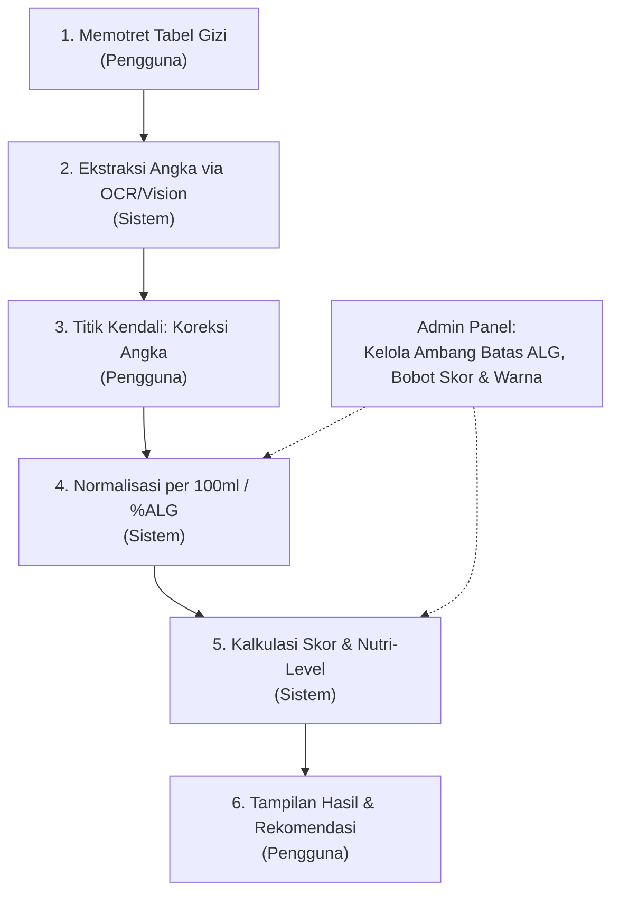

# PRODUCT REQUIREMENTS DOCUMENT (PRD)
## Foodscan: Aplikasi Pemindai Label Nutrisi Kemasan Cerdas

---

## 1. Ringkasan Eksekutif & Informasi Proyek
- **Nama Produk**: Foodscan (*Nutrisi Cerdas & Aman*)
- **Kategori**: Mobile Healthtech & Nutritech (Mata Kuliah Teknopreneur)
- **Target Platform**: Mobile Application (Android / iOS / Progressive Web App - PWA)
- **Status Dokumen**: Versi 1.0 (Draft Final untuk Pengembangan)
- **Penyusun**: Tim Pengembang Foodscan

---

## 2. Latar Belakang & Pernyataan Masalah (Problem Statement)
### 2.1 Masalah
1. **Rendahnya Literasi Gizi**: Sebagian besar konsumen di Indonesia kesulitan membaca dan menafsirkan tabel Informasi Nilai Gizi (ING) pada kemasan makanan/minuman yang penuh angka teknis dan persentase rumit.
2. **Keterbatasan Takaran Saji**: Angka pada tabel sering disajikan per "takaran saji" (serving size), bukan per kemasan, sehingga sering mengecoh konsumen mengenai total asupan kalori, gula, dan garam yang sebenarnya dikonsumsi.
3. **Peningkatan Penyakit Tidak Menular (PTM)**: Lonjakan kasus diabetes melitus, hipertensi, dan penyakit kardiovaskular sangat erat kaitannya dengan konsumsi gula, garam (natrium), dan lemak (GGL) berlebih.

### 2.2 Solusi: Foodscan
Aplikasi mobile berbasis kamera dan Vision AI / OCR yang mampu:
- Memotret tabel Informasi Nilai Gizi kemasan secara instan.
- Menerjemahkan angka-angka gizi ke dalam format terstruktur.
- Memberikan **titik kendali verifikasi manual** kepada pengguna sebelum dinilai.
- Mengklasifikasikan kualitas gizi produk ke dalam **Nutri-Level (Grade A - D)** dengan indikator warna visual (*Traffic Light System* / standar Nutri-Grade).

---

## 3. Profil Pengguna & Persona (Target Audience)
1. **Healthy Lifestyle Enthusiast / Diet Tracker**: Konsumen yang ingin menjaga berat badan dan membatasi asupan kalori/lemak harian.
2. **Penderita Komorbid / Kondisi Khusus**: Penderita diabetes (perlu membatasi gula) dan hipertensi (perlu membatasi natrium).
3. **Orang Tua / Ibu Rumah Tangga**: Ingin memastikan camilan dan minuman anak aman dari kandungan gula/garam tersembunyi.
4. **Masyarakat Umum & Mahasiswa**: Konsumen yang membutuhkan panduan visual cepat saat berbelanja di minimarket atau supermarket.

---

## 4. Alur Kerja Sistem (System Workflow - 6 Langkah)
Berdasarkan arsitektur alur kerja sistem Foodscan:

1. **Langkah 1 (Pengguna)**: Memotret label tabel Informasi Nilai Gizi kemasan menggunakan kamera aplikasi atau memilih gambar dari galeri.
2. **Langkah 2 (Sistem)**: Mesin OCR (Vision Model) memindai foto, mengenali label teks, dan mengekstrak entitas numerik (*Gula, Natrium, Lemak Total, Takaran Saji*).
3. **Langkah 3 (Pengguna - Titik Kendali)**: Pengguna meninjau hasil bacaan OCR dan dapat mengedit/mengoreksi angka sebelum sistem melakukan penilaian untuk menjamin akurasi 100%.
4. **Langkah 4 (Sistem)**: Menormalkan nilai zat gizi ke basis standar per 100 ml / 100 g atau mengalkulasi terhadap Acuan Label Gizi (ALG).
5. **Langkah 5 (Sistem)**: Menerapkan algoritma batas level (*thresholding*). Zat gizi yang dibatasi (gula, natrium, lemak jenuh) mengurangi skor, sedangkan serat dan protein memberikan nilai bonus.
6. **Langkah 6 (Pengguna)**: Menampilkan hasil akhir berupa Skor Nutrisi (0–100), Grade A–D, badge warna masing-masing zat gizi, dan ringkasan saran kesehatan.

---

## 5. Matriks Ambang Batas Nutrisi (Nutri-Level Matrix)
Berdasarkan acuan standar tabel Foodscan (kandungan per 100 ml produk siap konsumsi):

| Zat Gizi | Level A (Dark Green) | Level B (Light Green) | Level C (Yellow) | Level D (Red) | Satuan Acuan |
| :--- | :--- | :--- | :--- | :--- | :--- |
| **Gula** | $\le 0.5$ | $> 0.5 - \le 6.0$ | $> 6.0 - \le 12.5$ | $> 12.5$ | $\text{g} / 100\text{ ml}$ |
| **Natrium** | $\le 5.0$ | $> 5.0 - \le 120.0$ | $> 120.0 - \le 500.0$ | $> 500.0$ | $\text{mg} / 100\text{ ml}$ |
| **Lemak Total**| $\le 0.5$ | $> 0.5 - \le 3.0$ | $> 3.0 - \le 17.0$ | $> 17.0$ | $\text{g} / 100\text{ ml}$ |

### Logika Penentuan Grade Akhir (Nutri-Level Akhir):
- **Grade A (Dark Green)**: Kualitas nutrisi prima, sangat rendah gula, garam, dan lemak.
- **Grade B (Light Green)**: Kualitas nutrisi baik, batas moderat yang masih dianjurkan untuk konsumsi harian.
- **Grade C (Yellow)**: Mengandung gula, natrium, atau lemak dalam kadar cukup tinggi, disarankan batasi konsumsi.
- **Grade D (Red)**: Sangat tinggi gula, natrium, atau lemak jenuh. Tidak disarankan dikonsumsi rutin dalam jumlah besar.

---

## 6. Rincian Fitur Aplikasi (Functional Requirements)

### 6.1 Modul Kamera & Pemindai (Scanner Module)
- **FR-SCAN-01**: Tampilan kamera real-time dengan panduan bingkai pemotretan (*scanning viewport overlay* dengan sudut hijau).
- **FR-SCAN-02**: Kemampuan memilih gambar dari galeri perangkat (*Upload Gallery*).
- **FR-SCAN-03**: Fitur pratinjau foto dengan tombol "Ganti Foto" dan status "Foto Siap Dianalisis".
- **FR-SCAN-04**: Tombol eksekusi utama *"Analisis Label Sekarang"*.

### 6.2 Modul Pengenalan Karakter Optik (OCR / Vision Extraction)
- **FR-OCR-01**: Ekstraksi otomatis parameter kunci:
  - Takaran Saji (ml / gram) dan Jumlah Sajian per Kemasan.
  - Energi Total (kkal).
  - Gula Total (g).
  - Natrium / Garam (mg).
  - Lemak Total (g) & Lemak Jenuh (g).
  - Protein & Serat Pangan (jika tertera).
- **FR-OCR-02**: Penanganan kondisi pencahayaan rendah atau foto miring dengan auto-preprocessing (contrast & deskew).

### 6.3 Modul Verifikasi & Koreksi (Human-in-the-Loop Control)
- **FR-EDIT-01**: Menampilkan formulir input angka hasil ekstraksi OCR sebelum kalkulasi skor dijalankan.
- **FR-EDIT-02**: Pengguna dapat mengubah angka yang keliru terdeteksi.
- **FR-EDIT-03**: Tombol konfirmasi *"Lanjut ke Penilaian"*.

### 6.4 Modul Penilaian & Hasil (Nutri-Grade & Score Display)
- **FR-RES-01**: Tampilan **Skor Keseluruhan (0 - 100)** dan badge **Nutri-Grade (A, B, C, atau D)**.
- **FR-RES-02**: Rincian kartu per zat gizi lengkap dengan label warna (*Dark Green, Light Green, Yellow, Red*).
- **FR-RES-03**: Rekomendasi/Saran konsumsi (contoh: *"Produk ini mengandung gula Level C, batasi jika Anda sedang diet rendah gula"*).
- **FR-RES-04**: Tombol simpan ke Riwayat (*Save to History*) atau Bagikan (*Share Result*).

### 6.5 Modul Riwayat & Manajemen Produk (History & Database)
- **FR-HIST-01**: Menyimpan daftar riwayat produk yang pernah dipindai beserta tanggal, nama produk, foto thumbnail, dan grade akhir.
- **FR-HIST-02**: Fitur pencarian dan filter berdasarkan kategori grade (A/B/C/D).

### 6.6 Modul Profil & Personalisasi (User Profile)
- **FR-PROF-01**: Informasi dasar pengguna (Nama, Foto profil, preferensi tema gelap/terang).
- **FR-PROF-02**: Pengaturan preferensi kesehatan khusus (e.g. Diabetisi, Hipertensi, Rendah Lemak) yang dapat memberikan peringatan (*alert*) kustom jika kadar zat tertentu melebihi batas aman pengguna.

---

## 7. Kebutuhan Non-Fungsional (Non-Functional Requirements)
1. **Performa & Latensi**:
   - Waktu respons pemrosesan OCR hingga memunculkan angka: $< 3\text{ detik}$.
   - Waktu kalkulasi skor gizi: $< 200\text{ ms}$.
2. **Usability & UX**:
   - Desain antarmuka modern, responsif, dan *clean* (menggunakan palet hijau kesehatan: Forest Green, Mint Green, Neutral Gray).
   - Indikator warna aksesibel (memperhatikan kontras teks dan keterbacaan untuk penderita buta warna parsial).
3. **Keandalan & Akurasi**:
   - Model OCR memiliki akurasi pengenalan teks numerik $> 85\%$ pada label kemasan berstandar BPOM.
   - Titik kendali manual menjamin tidak ada kesalahan kalkulasi akibat kegagalan baca OCR.
4. **Kompatibilitas**:
   - Kompatibel dengan Android 8.0+ dan iOS 14+ (jika dibuild cross-platform) atau browser modern (Chrome/Safari) jika menggunakan PWA.

---

## 8. Arsitektur Teknologi yang Direkomendasikan
- **Frontend Mobile**: React Native (Expo) / Flutter / Next.js PWA (seperti yang terlihat berjalan di browser port `:3000` pada mockup).
- **OCR Engine**: Google ML Kit (Text Recognition) on-device / Tesseract.js / Gemini Flash Multimodal API untuk ekstraksi data tabel nutrisi dengan akurasi tinggi.
- **Backend / Database**: Supabase / Firebase / Node.js Express (REST API untuk sinkronisasi histori dan konfigurasi ambang batas admin).

---

## 9. Rencana Roadmap Pelaksanaan (Roadmap Proyek)
- **Fase 1 (Minggu 1-2)**: Desain UI/UX & Wireframing (Kamera, Form Koreksi, Kartu Skor).
- **Fase 2 (Minggu 3-4)**: Integrasi Engine Pemindai & Algoritma Kalkulasi Nutri-Grade (sesuai matriks sheet Excel).
- **Fase 3 (Minggu 5)**: Pengembangan Fitur Koreksi Manual, Riwayat, dan Profil Pengguna.
- **Fase 4 (Minggu 6)**: Testing User Experience, Validasi Akurasi OCR pada sampel kemasan riil, dan Penyusunan Laporan Proyek Teknopreneur.
