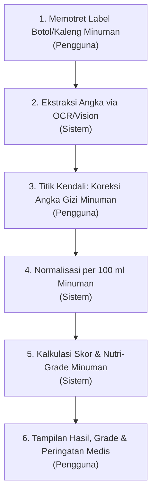

# PRODUCT REQUIREMENTS DOCUMENT (PRD)
## NutriSip: Aplikasi Pemindai Nutrisi Minuman Kemasan Cerdas

---

## 1. Ringkasan Eksekutif & Informasi Proyek
- **Nama Produk**: NutriSip (*Nutrisi Minuman Cerdas & Sehat*)
- **Kategori**: Mobile Healthtech & Nutritech (Mata Kuliah Teknopreneur)
- **Target Platform**: Mobile Application (Android / iOS / Expo)
- **Status Dokumen**: Versi 2.0 (Spesialisasi Pemindai Minuman Kemasan)
- **Penyusun**: Tim Pengembang NutriSip

---

## 2. Latar Belakang & Pernyataan Masalah (Problem Statement)
### 2.1 Masalah
1. **Bahaya Gula Tersembunyi pada Minuman (MBDK)**: Minuman Berpemanis Dalam Kemasan (seperti teh kemasan, kopi susu kalengan, minuman soda, boba, dan jus kemasan) menyumbang asupan gula cair terbesar yang sangat cepat diserap oleh tubuh, memicu lonjakan diabetes melitus tipe 2 dan obesitas usia muda.
2. **Keterbacaan Takaran Saji Minuman**: Label kemasan minuman sering kali menampilkan nilai per 100 ml atau per takaran saji (misal: botol 450 ml dengan takaran saji 200 ml), sehingga konsumen mengira kandungan gulanya sedikit padahal jika dihabiskan satu botol, asupan gula melampaui batas harian Kemenkes.
3. **Kebutuhan Standar Nutri-Grade Cairan**: Standar internasional (seperti Nutri-Grade Singapura) secara khusus mengklasifikasikan produk minuman cair ke dalam Grade A–D berdasarkan kadar gula dan lemak jenuh per 100 ml.

### 2.2 Solusi: NutriSip
Aplikasi mobile berbasis kamera dan Vision AI / OCR yang:
- Memotret tabel Informasi Nilai Gizi pada botol, kaleng, atau kotak minuman.
- Menerjemahkan angka-angka gizi ke dalam format terstruktur per 100 ml.
- Memberikan **titik kendali verifikasi manual** kepada pengguna sebelum dinilai.
- Mengklasifikasikan kualitas minuman ke dalam **Nutri-Grade (Level A - D)** dengan indikator warna visual (*Traffic Light System*).

---

## 3. Profil Pengguna & Persona (Target Audience)
1. **Konsumen Minuman Manis Harian**: Mahasiswa dan pekerja yang gemar membeli kopi susu kalengan, teh kemasan botol, atau minuman boba.
2. **Penderita Diabetes / Pre-Diabetes**: Membutuhkan pengawasan ketat terhadap gula cair minuman yang sangat rawan menyebabkan lonjakan glukosa darah.
3. **Penderita Hipertensi**: Memerlukan peringatan terhadap kandungan natrium tinggi pada minuman isotonik dan elektrolit.
4. **Pegiat Gaya Hidup Sehat & Diet Rendah Kalori**: Membatasi konsumsi krimer kental manis dan minuman berlemak tinggi.

---

## 4. Alur Kerja Sistem (System Workflow - 6 Langkah)

1. **Langkah 1 (Pengguna)**: Memotret label tabel Informasi Nilai Gizi botol/kaleng minuman atau memilih gambar dari galeri.
2. **Langkah 2 (Sistem)**: Mesin OCR mengenali tabel gizi minuman dan mengekstrak entitas numerik (*Gula Cair, Natrium, Lemak Total, Takaran Saji ml*).
3. **Langkah 3 (Pengguna - Titik Kendali)**: Pengguna memeriksa dan mengoreksi angka pembacaan jika ada kesalahan deteksi sebelum dinilai.
4. **Langkah 4 (Sistem)**: Menormalkan nilai gizi ke basis standar per 100 ml produk minuman siap konsumsi.
5. **Langkah 5 (Sistem)**: Menghitung skor total (0–100) dan menentukan level warna A–D per zat gizi.
6. **Langkah 6 (Pengguna)**: Menampilkan hasil akhir berupa Skor Nutrisi Minuman, Grade A–D, badge warna, dan peringatan personal (misal: alert diabetes jika gula Level C/D).

---

## 5. Matriks Ambang Batas Nutrisi Minuman (Per 100 ml Minuman Siap Konsumsi)

| Zat Gizi Minuman | Level A (Dark Green) | Level B (Light Green) | Level C (Yellow) | Level D (Red) | Satuan Acuan |
| :--- | :--- | :--- | :--- | :--- | :--- |
| **Gula Cair** | $\le 0.5$ | $> 0.5 - \le 6.0$ | $> 6.0 - \le 12.5$ | $> 12.5$ | $\text{g} / 100\text{ ml}$ |
| **Natrium** | $\le 5.0$ | $> 5.0 - \le 120.0$ | $> 120.0 - \le 500.0$ | $> 500.0$ | $\text{mg} / 100\text{ ml}$ |
| **Lemak Total**| $\le 0.5$ | $> 0.5 - \le 3.0$ | $> 3.0 - \le 17.0$ | $> 17.0$ | $\text{g} / 100\text{ ml}$ |

### Interpretasi Nutri-Grade Minuman:
- **Grade A (Dark Green)**: Minuman sangat sehat, bebas atau sangat rendah gula (contoh: air mineral, teh tawar, susu murni tanpa pemanis).
- **Grade B (Light Green)**: Minuman sehat, kadar gula moderat dan aman untuk konsumsi harian.
- **Grade C (Yellow)**: Waspada, mengandung gula atau natrium cukup tinggi (contoh: teh kemasan standar, minuman isotonik).
- **Grade D (Red)**: Sangat tinggi gula cair (contoh: soda manis, kopi susu krimer kental). Tidak dianjurkan untuk dikonsumsi rutin.
